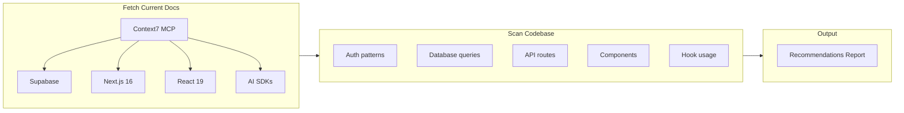

# Context7 Codebase Analysis

Comprehensive analysis of Atlas codebase against current library documentation, outputting a markdown report with recommendations.

## Your Stack

| Library | Version | Context7 ID ||---------|---------|-------------|| Next.js | 16.0.7 | `/vercel/next.js` || React | 19.2.2 | `/facebook/react` || Supabase JS | 2.86.0 | `/supabase/supabase` || Supabase SSR | 0.8.0 | `/supabase/supabase` || Anthropic SDK | 0.71.2 | `/anthropics/anthropic-sdk-typescript` || Google GenAI | 0.24.1 | `/google/generative-ai` || Tailwind | 4.x | `/tailwindlabs/tailwindcss` |

## Analysis Approach




## Analysis Areas

### 1. Supabase Patterns

- **Auth**: Check `AuthContext.tsx`, middleware, SSR cookie handling
- **Database**: Query patterns, RLS usage, type generation
- **Storage**: Media handling in `media.ts`
- **Realtime**: Any subscription patterns

### 2. Next.js 16 Patterns

- **App Router**: Route handlers, layouts, loading states
- **Server Components**: Proper client/server boundaries
- **Caching**: Fetch caching, revalidation strategies
- **Middleware**: Auth flow in `middleware.ts`

### 3. React 19 Patterns

- **New Hooks**: `use`, `useOptimistic`, `useFormStatus`
- **Server Components**: Async components, streaming
- **Transitions**: `useTransition` for non-blocking updates

### 4. AI SDK Patterns

- **Anthropic**: Streaming, tool use, error handling
- **Google GenAI**: Media analysis patterns (you have video analysis tests)

## Output

A markdown report saved to `docs/CONTEXT7_ANALYSIS.md` with:

1. **Executive Summary**: Key findings at a glance
2. **Per-Library Analysis**: Current patterns vs. recommendations
3. **Priority Fixes**: Ranked by impact and effort
4. **Code Examples**: Before/after for each recommendation

## Key Files to Analyze

- [src/context/AuthContext.tsx](src/context/AuthContext.tsx) - Auth patterns
- [src/middleware.ts](src/middleware.ts) - Next.js middleware
- [src/lib/supabase.ts](src/lib/supabase.ts) - Client setup
- [src/lib/supabase-server.ts](src/lib/supabase-server.ts) - Server setup
- [src/lib/ai/](src/lib/ai/) - AI integration patterns
- [src/app/api/](src/app/api/) - Route handlers

## Safety

- **Read-only analysis** - no code changes

---

# Phase 2: Implementation (Pending)

Analysis complete. Ready to implement the following recommendations:

## Implementation Tasks

### 1. Add Next.js 16 Cache APIs (`impl-cache-apis`)

**File:** [src/lib/data.ts](src/lib/data.ts)Add `cacheLife()` and `cacheTag()` to data fetching functions:

```typescript
"use cache";
import { cacheLife, cacheTag } from "next/cache";

export async function fetchDenizens() {
  "use cache";
  cacheLife("hours");
  cacheTag("denizens");
  // existing fetch logic
}
```

**Impact:** Reduce Supabase calls by 90%+, faster page loads

### 2. Create Server Actions (`impl-server-actions`)

**File:** `src/app/actions/entities.ts` (new)Move entity mutations from API routes to Server Actions:

```typescript
"use server";
import { revalidateTag } from "next/cache";

export async function createEntity(formData: FormData) {
  // Direct Supabase access
  revalidateTag("denizens");
}
```


### 3. Use Form Component (`impl-form-component`)

**File:** [src/app/admin/new-entity/page.tsx](src/app/admin/new-entity/page.tsx)Replace `<form>` with `<Form>` from `next/form` for progressive enhancement.

### 4. Add useOptimistic (`impl-use-optimistic`)

**File:** [src/components/forge/ForgeVideoCard.tsx](src/components/forge/ForgeVideoCard.tsx)Add instant approval feedback:

```typescript
const [optimisticStatus, addOptimistic] = useOptimistic(status);

async function handleApprove() {
  addOptimistic('approved');
  await approveGeneration(id);
}
```


### 5. Use useActionState (`impl-use-action-state`)

Replace manual form state management with React 19's `useActionState` for:

- Entity creation forms